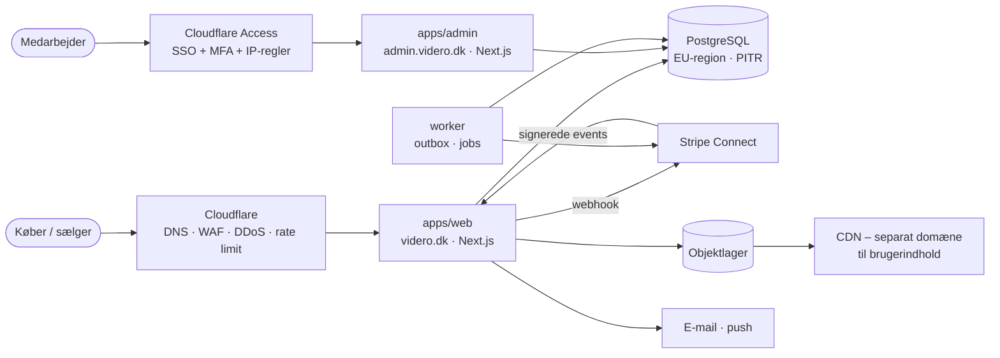
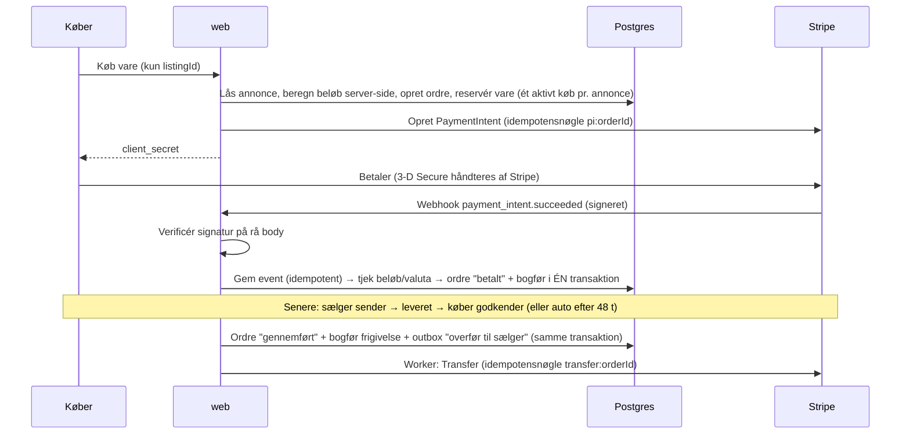

# 01 · Arkitektur

## Principper

1. **Modulær monolit, ikke mikroservices.** Én kodebase og én database. Moduler har skarpe grænser (`packages/*`), så de kan skilles ud senere, hvis målinger kræver det.
2. **Domænet har ingen I/O.** Penge, gebyrer, tilstandsmaskine og bogholderi ligger i `packages/core` og kan testes uden database og netværk.
3. **Databasen forsvarer sine egne invarianter.** Kritiske regler (ingen dobbeltsalg, balanceret ledger, uforanderlig historik, frosne beløb) håndhæves med constraints og triggers, så en fejl i koden ikke kan bryde dem.
4. **Serveren bestemmer alle beløb.** Klienten sender aldrig pris, gebyr eller fragt.
5. **Eksterne sideeffekter via outbox.** Stripe-kald skrives i samme transaktion som ordreændringen og udføres bagefter med idempotensnøgler.
6. **Tynde apps, tykke pakker.** `apps/*` binder sammen; logikken bor i `packages/*`.

## Systemoverblik

## Subdomæner og domæner

| Navn | Formål | Beskyttelse |
|---|---|---|
| `videro.dk` (+ `www` → redirect) | Forbrugersite og app | Cloudflare WAF, rate limiting, strikt CSP |
| `admin.videro.dk` | Medarbejdere: moderation, ordrer, refunderinger, gebyrer | **Cloudflare Access** (SSO + MFA) + IP-allowlist + app-niveau tjek + `noindex` |
| *(senere)* `pro.videro.dk` | Dashboard for erhvervs-/certificerede sælgere | Egen app, samme adgangsmønster som web (rigtige brugere, ikke Access) |
| Separat registrerbart domæne til billeder (fx `respin-cdn.dk`) | Brugeruploadet indhold | Cookie-løst; isolerer XSS-risiko fra brugerindhold fra hoveddomænet |
| `status.videro.dk`, `mail.videro.dk` | Statusside, afsender-domæne | SPF + DKIM + DMARC; ingen dinglende DNS-poster |

Hvert subdomæne er **sin egen app med sin egen deploy og egne cookies** (aldrig `Domain=.videro.dk`-cookies). Det er mere robust end at skille dem ad med host-baseret middleware i én app.

## Teknologivalg

| Lag | Valg | Hvorfor | Alternativer / genovervej når |
|---|---|---|---|
| Sprog | TypeScript overalt | Delte typer mellem UI, API og domæne; UI-kittet er allerede React/TS | – |
| Web | Next.js (App Router) + `@respin/ui` | SEO på annoncer (server-rendering) er en vigtig kanal; kittet findes | Remix/React Router; Rails som Vinted (ville miste UI-kit og delte typer) |
| Database | PostgreSQL + Drizzle | Transaktioner, constraints, triggers, JSONB; typesikre queries uden magi | Prisma (mere magi, ingen triggers i skema); MySQL+Vitess (Vinteds valg ved meget stor skala) |
| Betalinger | Stripe Connect | Hold ikke andres penge selv (regulering, KYC); danske betalingsmetoder | Mangopay / Adyen for Platforms (markedsplads-specifikke) – undersøg hvis MobilePay + tilbageholdte penge ikke kan kombineres |
| Baggrundsjobs | Postgres-baseret outbox + worker | Færre bevægelige dele; transaktionel konsistens | BullMQ/Redis, Inngest, Trigger.dev når volumen eller scheduling kræver det |
| Søgning | Postgres fuldtekst/`pg_trgm` først | God nok til MVP; ingen ekstra drift | Typesense/Meilisearch → Elasticsearch/Vespa (som Vinted) ved mange annoncer |
| Realtid (chat) | Managed (Ably/Pusher) først | Websockets i drift er dyrt at gøre rigtigt | Egen WS-server + Redis pub/sub |
| Billeder | S3-kompatibelt lager + CDN + omkodning i worker | Fjerner EXIF/GPS, begrænser pixelloft, genererer størrelser | Cloudflare Images |
| Auth | Se [ADR-003](06-decisions.md) | Passkeys + MFA, sessioner i egen DB | Managed (Clerk/WorkOS) |
| Admin-adgang | Cloudflare Access + app-verifikation | SSO/MFA/IP før trafikken når os | Tailscale/VPN, egen SSO |
| Hosting | Vercel (web/admin) + container-host til worker + managed Postgres i EU | Hurtig start; worker kan ikke være serverless | AWS/Fly/Hetzner ved behov for kontrol eller pris |

## Datamodel (`packages/db/src/schema.ts`)

| Område | Tabeller |
|---|---|
| Identitet | `users`, `seller_profiles` (certificering, Stripe-konto, KYC-status), `staff_users` |
| Marked | `listings`, `listing_images`, `favorites` |
| Kommunikation | `conversations`, `messages` (med `risk_level`), `offers` |
| Ordrer | `orders` (frosne beløb, optimistisk lås), `order_events` (append-only) |
| Penge | `ledger_transactions`, `ledger_entries` (append-only, balanceret), `outbox`, `stripe_events` (idempotens) |
| Tillid | `reports`, `audit_log` (append-only) |

Auth-bibliotekets egne tabeller (sessions, passkeys, konti) tilføjes, når auth-valget er truffet.

## Vigtigste flows

**Køb (sekvens):**

Ordrens tilstande og overgange står i [03-payments.md](03-payments.md).

## Skalering (kun når målinger kræver det)

1. **Nu → tusindvis af annoncer:** én Postgres, Postgres-søgning, CDN foran billeder.
2. **Titusinder:** læse-replika til feed/søgning, dedikeret søgemaskine, kø med Redis, caching af annoncesider (ISR) på de sider der ikke bruger nonce-CSP – eller flyt til hash-baseret CSP.
3. **Hundredtusinder+:** partitionering af store tabeller (`messages`, `audit_log`, `ledger_entries`), eventuelt udskilning af chat og søgning som egne services.

Optimér ikke på forhånd. Mål først (p95-svartid, databasebelastning), og skriv ned, hvad der udløser næste trin.
