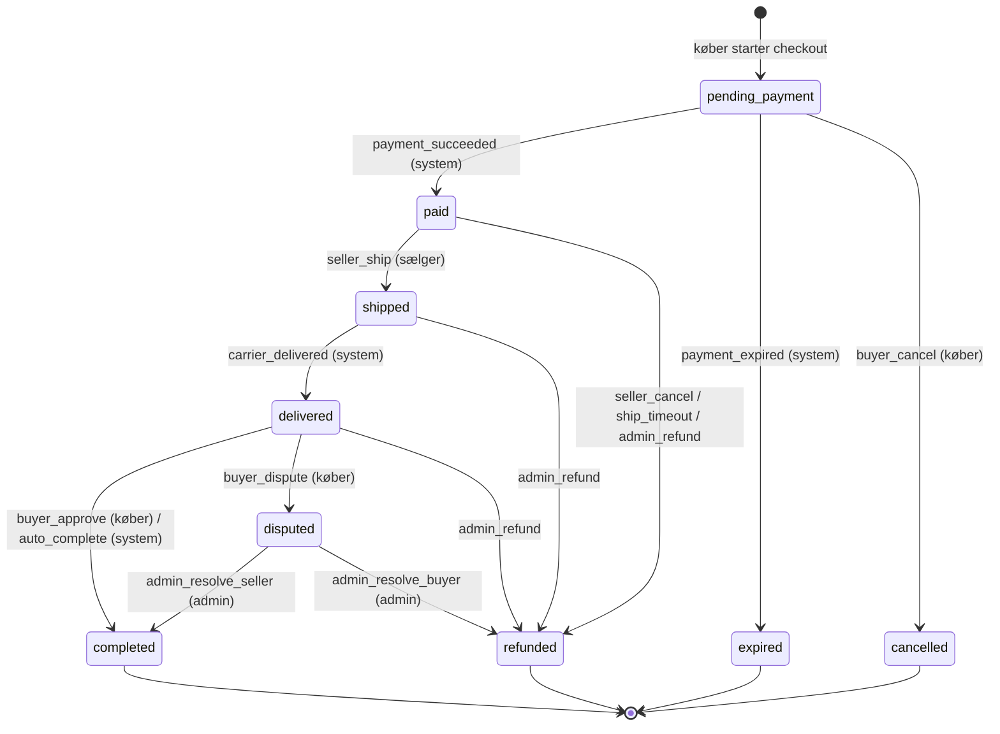
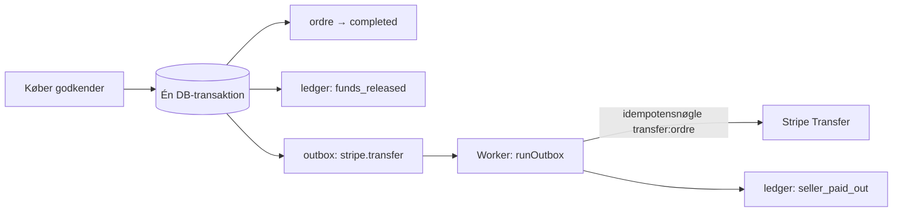

# 03 · Betalinger og penge

Alt her er implementeret i `packages/core` (regler), `packages/db` (invarianter) og `packages/payments` (Stripe-integration), og testet mod en rigtig Postgres med en falsk Stripe-gateway og ægte webhook-signaturer. **Ikke afprøvet mod Stripes rigtige API.**

## Regler

| Regel | Værdi | Kode |
|---|---|---|
| Køberbeskyttelse | 5 % + 3 kr. af varens pris | `buyerProtectionFee` |
| Gebyr til Videro ved salg | 1 % (0,5 % for certificerede sælgere) | `sellerFee` |
| Fragt | Fast pris pr. pakkestørrelse, bestemt af serveren | `SHIPPING_PRICE_ORE` |
| Beløb | Heltal i øre, aldrig kr. med decimaler; loft 1.000.000 kr. pr. beløb, 100.000 kr. pr. annonce | `money.ts`, DB-`CHECK` |
| Afrunding | Half-up til hele øre | `percentOf` |
| Betalingsvindue | 30 min., derefter udløber ordren og varen frigives | `PAYMENT_WINDOW_MINUTES` |
| Afsendelsesfrist | 5 dage, ellers automatisk refundering | `SHIP_DEADLINE_DAYS` |
| Reklamationsvindue | 48 timer efter levering, ellers frigives pengene automatisk | `AUTO_COMPLETE_AFTER_HOURS` |

Beløbene på en ordre **beregnes én gang ved oprettelse og fryses** (også certificeringsstatus). Senere ændringer af satser påvirker aldrig eksisterende ordrer; databasen afviser ændringer af beløb.

> UI'et (`@respin/ui/utils`) har en ældre kopi af gebyrberegningen, der afrunder til hele kroner. **`packages/core` er kilden til sandhed.** Når checkout-UI bygges, skal det vise beløb fra serveren, og kopien i UI-kittet fjernes.

## Ordrens tilstande

Alt går gennem `transition()` (rent) og `applyOrderEvent()` (database). Egenskaber, der er bevist med udtømmende tests: man kan ikke springe trin over; kun den rette aktør kan udløse hver overgang; **sælgeren kan aldrig frigive sine egne penge**; penge frigives kun efter levering eller afgjort tvist; afsluttede ordrer kan ikke ændres (også ikke af admin, og databasen forhindrer det).

## Bogholderi (dobbelt)

Hver pengebevægelse er en transaktion med linjer, hvor sum(debet) = sum(kredit). Databasen afviser ubalancerede transaktioner ved commit, og linjer kan aldrig ændres eller slettes (rettelser = modposteringer).

| Hændelse | Debet | Kredit |
|---|---|---|
| **Betaling modtaget** | `asset:stripe_balance` (samlet) | `liability:escrow:<ordre>` (pris) · `liability:buyer_fee_held:<ordre>` · `liability:shipping_held:<ordre>` |
| **Gennemført** (penge frigives) | escrow (pris) · buyer_fee_held · shipping_held | `liability:seller_payable:<sælger>` (pris − sælgergebyr) · `revenue:seller_fee` · `revenue:buyer_fee` · `liability:carrier_payable` |
| **Overført til sælger** | `seller_payable:<sælger>` | `asset:stripe_balance` |
| **Refunderet** | escrow · buyer_fee_held · shipping_held | `asset:stripe_balance` (alt tilbage til køber) |

Hver postering har en **idempotensnøgle** (`payment_captured:<ordre>`, `funds_released:<ordre>` …), så en gentaget webhook eller et genforsøg aldrig bogfører to gange. Egenskab testet på tværs af mange priser (inkl. ulige øre): efter betaling → frigivelse → udbetaling står escrow og seller_payable i nul, og Stripe-saldoen svarer præcis til vores indtægt + skyldig fragt.

## Stripe-model

- **Stripe Connect, "separate charges and transfers".** Vi opkræver køber på platformen, holder pengene, og overfører til sælgers Connect-konto, når ordren er gennemført. Stripe lister Danmark som understøttet region. Stripe kalder det ikke juridisk "escrow"; om og hvordan modellen er tilladt for jer skal afklares ([beslutninger](04-roadmap.md#beslutninger-der-kræver-dig)).
- **Sælger-onboarding:** hostet Connect-onboarding (Express) → KYC og bankkonto hos Stripe. Vi gemmer kun `stripe_account_id`, `payouts_enabled` og `kyc_status`. **Ingen bankoplysninger hos os.**
- **`source_transaction`:** overførslen knyttes til den oprindelige betaling (`stripeChargeId`), så den kan ske, selv før Stripe-saldoen er frigivet.
- **MobilePay:** Stripe understøtter MobilePay som betalingsmetode, men dokumentationen er modstridende om, hvilke Connect-chargetyper det kan bruges med. **Skal afklares med Stripe, før MobilePay lover køberne beskyttelse.**
- **Gebyrøkonomi:** 1 % fra sælger er mindre end typiske kortgebyrer. Det er købers gebyr (5 % + 3 kr.), der dækker betalingsomkostningerne. **Regn efter med Stripes aktuelle priser** (inkl. MobilePay-gebyrer og Connect-gebyrer) før priser fastlåses.

## Outbox: hvorfor penge ikke går tabt eller dobbeltbetales

- Stripe-kald sker **uden for** databasetransaktionen (ingen låse under netværkskald).
- Nedbrud efter Stripe-kaldet → worker kører igen → **samme idempotensnøgle** → Stripe returnerer samme overførsel → bogføring sker én gang (testet).
- Fejl → eksponentiel backoff (2, 4, 8 … min.), efter 8 forsøg status `failed` (**skal give alarm**).
- Sælger uden færdig onboarding → pengene ligger sikkert som `seller_payable` og prøves igen (testet).

## Fejlscenarier

| Scenarie | Opførsel | Test |
|---|---|---|
| Webhook leveres to gange | Anden gang er en no-op (`duplicate`), intet bogføres to gange | ✅ |
| Webhook med forkert/manglende/gammel signatur | 400, intet gemmes | ✅ |
| Betaling med forkert beløb/valuta/PaymentIntent | Ordre forbliver ubetalt, audit-log `payment.mismatch`, 500 → Stripe prøver igen | ✅ |
| Betaling efter ordren er udløbet | Automatisk refundering, intet bogføres | ✅ |
| Stripe nede ved checkout | Ordren udløber, varen frigives igen | ✅ |
| To købere samtidig | Kun én får varen (unikt delvist indeks) | ✅ |
| To samtidige overgange på samme ordre | Kun én lykkes (række-lås + versionsnummer) | ✅ |
| Fremmed bruger forsøger at ændre ordre | "Findes ikke" – ingen information | ✅ |
| Server går ned efter Stripe-overførsel | Genkørsel er sikker (idempotens) | ✅ |
| Tvist | Kun admin kan afgøre; pengene frigives/refunderes først derefter | ✅ |
| **Chargeback (`charge.dispute.created`)** | Skal fryse udbetaling, indsamle beviser, bogføre tab | ⬜ |
| **Refundering efter udbetaling** | Kræver clawback/negativ saldo hos sælger | ⬜ |
| **Ledger ≠ Stripe** | Daglig afstemning mod Stripe balance transactions → alarm | ⬜ |
| Delvis refundering, flere betalinger pr. ordre | Ikke understøttet i skelettet | ⬜ |

## Fremhævning af annoncer

Sælgere kan købe fremhævning af egne annoncer (1 dag 19 kr, 3 dage 39 kr, 7 dage 69 kr – `packages/core/src/promotions.ts`). Fremhævede annoncer står først i feed, kategori og søgning med mærket «Fremhævet».

- Prisen fastfryses fra pakken på serveren (aldrig fra klienten) i `listing_promotions` med status `pending`, og køber sendes til **Stripe Checkout** (ikke Connect – pengene er platformens omsætning).
- Fremhævningen aktiveres **kun** af en signeret `checkout.session.completed` med `metadata.kind = promotion`, og kun når session-id, beløb, valuta (DKK) og `payment_status = paid` passer præcist. Ellers: audit-log `promotion.payment_mismatch` og intet aktiveres. Samme event igen ændrer intet.
- Flere køb på samme annonce lægges i forlængelse af hinanden (række-lås på annoncens fremhævninger).
- `payment_intent.*`-events for fremhævninger ignoreres, så de ikke behandles som ordrer.
- Uden Stripe-nøgler kan fremhævning aktiveres gratis i udvikling, eller i produktion med `PROMOTIONS_TEST_MODE=1`.

## Åbne spørgsmål

1. Kan I holde købers penge via Connect (separate charges and transfers) inden for gældende regler for jeres virksomhedsform – eller kræves en anden model/licens? *(juridisk/Stripe)*
2. MobilePay + Connect + tilbageholdte penge: understøttet? *(Stripe)*
3. Moms på gebyrer (køberbeskyttelse og sælgergebyr) og regnskabsbehandling. *(revisor)*
4. Hvor længe må penge holdes, og hvad sker der ved sælgers konkurs/lukning af konto? *(Stripe/jurist)*
5. Udbetalingsgrænser og -pauser for nye sælgere: hvor strenge, uden at skræmme ærlige sælgere væk? *(produkt + risiko)*
